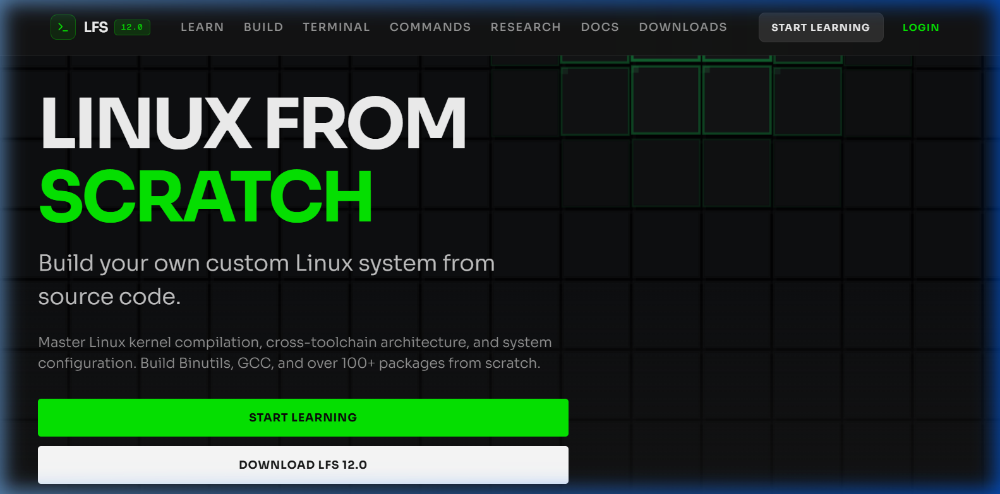
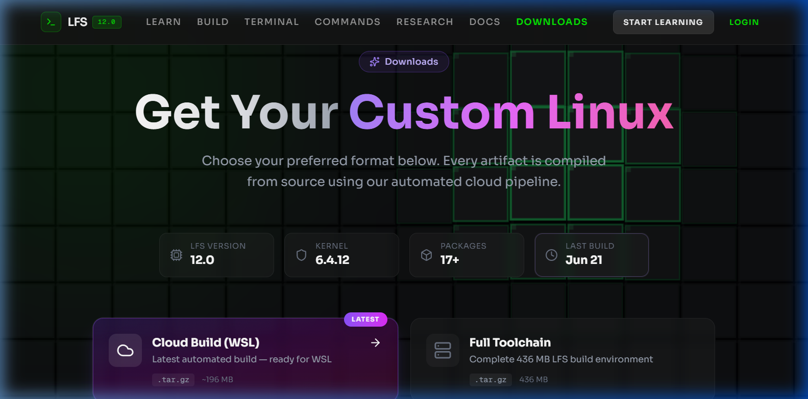
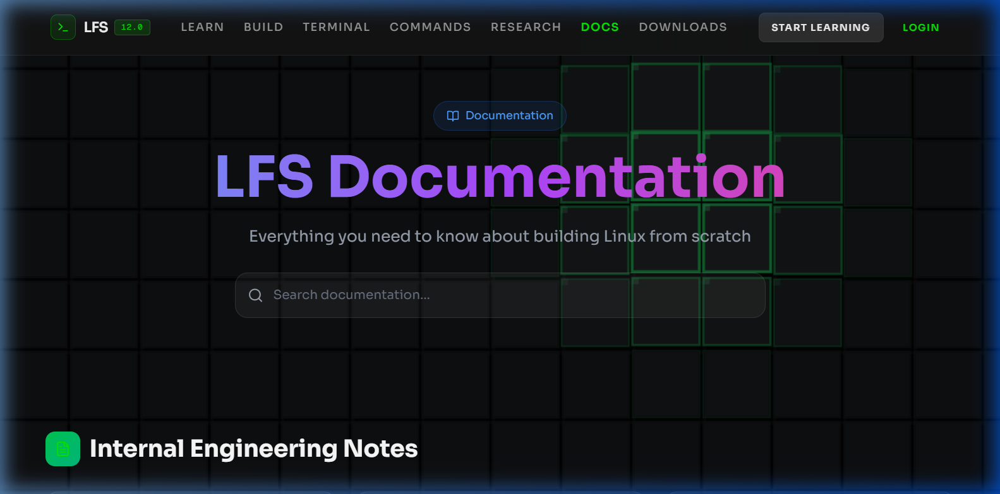
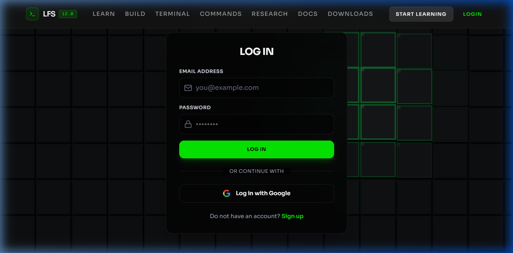
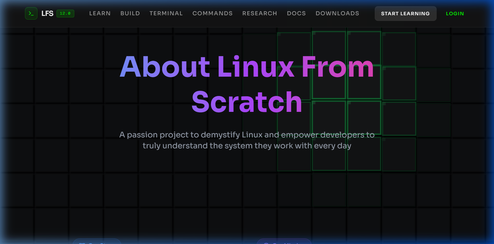

<div align="center">


<br/><br/>

```
██╗     ███████╗███████╗    ██████╗ ██╗   ██╗██╗██╗     ██████╗ ███████╗██████╗
██║     ██╔════╝██╔════╝    ██╔══██╗██║   ██║██║██║     ██╔══██╗██╔════╝██╔══██╗
██║     █████╗  ███████╗    ██████╔╝██║   ██║██║██║     ██║  ██║█████╗  ██████╔╝
██║     ██╔══╝  ╚════██║    ██╔══██╗██║   ██║██║██║     ██║  ██║██╔══╝  ██╔══██╗
███████╗██║     ███████║    ██████╔╝╚██████╔╝██║███████╗██████╔╝███████╗██║  ██║
╚══════╝╚═╝     ╚══════╝    ╚═════╝  ╚═════╝ ╚═╝╚══════╝╚═════╝ ╚══════╝╚═╝  ╚═╝
```

### **Build Your Own Linux System — From Zero to Bootable**

*Interactive learning platform · Cloud build pipeline · Practice lab targets · Multiple download formats*

**[🌐 Live Site](https://lfs-learning-platform.vercel.app)** · **[📖 Docs](https://lfs-learning-platform.vercel.app/docs)** · **[⬇️ Downloads](https://lfs-learning-platform.vercel.app/downloads)** · **[🏗️ Cloud Build](https://lfs-learning-platform.vercel.app/build)** · **[🎯 Vuln Hub](https://lfs-learning-platform.vercel.app/vuln-hub)** · **[🧭 Architecture](https://lfs-learning-platform.vercel.app/architecture)**

</div>

---

## 📌 What Is This?

**Linux From Scratch Builder** is a full-stack platform that teaches you how to compile a custom Linux operating system from source code — exactly as described in the LFS Book 12.0. It combines:

- 🎓 A **structured learning platform** with interactive lessons and progress tracking
- ☁️ An **automated Google Cloud Run pipeline** that compiles the full LFS system in staged jobs (measured 42–48 minutes on the last runs; you don't have to wait hours locally)
- 📦 **Ready-to-use artifacts**: WSL tarball, bootable ISO, full toolchain, practice-labs image, and Windows installer
- 🎯 **Practice lab targets** — OWASP Juice Shop, DVWA and WebGoat/WebWolf, pre-installed in the labs image with written walkthroughs
- 🔐 **Firebase authentication** with per-user progress saved to Firestore

> Built by [Shubham Bhasker](https://github.com/0xDracarys) as a capstone systems project — blending OS-level engineering with modern full-stack development.

---

## 📸 Screenshots

### 🏠 Homepage — Interactive Hero

> The full-screen interactive block wall background with real-time mouse parallax. The "LINUX FROM SCRATCH" heading uses fluid `clamp()` typography.

### ⬇️ Downloads — Artifact Selector

> Animated card selector lets users choose between WSL tarball, bootable ISO, full toolchain, and Windows installer. The detail panel updates live with install steps.

### 📖 Documentation

> Dynamic Markdown renderer powered by a Next.js API route. Docs are stored as `.md` files in `/public/docs/` and served with syntax highlighting.

### 👤 Authentication

> Firebase Auth-backed login page. Supports Google OAuth and email/password. The same dark glassmorphism aesthetic runs throughout the auth flow.

### ℹ️ About — Creator Profile

> Full creator profile with technical skills, project goals, GitHub links, and the platform's mission statement.

---

## 🎯 Practice Labs (Vuln Hub)

The labs image ships three deliberately vulnerable applications, already configured and wired to a local database. `/vuln-hub` is the entry point; every card links to its own walkthrough.

| Target | Version | Port | Access |
|---|---|---|---|
| **OWASP Juice Shop** | 20.3.0 (Node 22.14.0) | `3000` | open the app, register a user |
| **DVWA** | master (PHP 8.2.13 · MariaDB 11.4.5) | `80` | `admin` / `password` |
| **WebGoat + WebWolf** | 8.2.2 (Java 17.0.21) | `8080` / `9090` | register a new user |

MariaDB listens on `127.0.0.1:3307` (database `dvwa`, user `dvwa`) — deliberately not 3306, because Windows' own MySQL frequently owns that port inside WSL2.

```bash
vulnbox-start     # start every installed target, then print a status table
vulnbox-stop      # stop them
vulnbox-tunnel 3000   # expose one through a throwaway public HTTPS URL (cloudflared)
```

`vulnbox-start` probes each target after launching it and reports `up` or `no response`, then prints every problem in a single **Warnings** block — it does not print a green line for a service that never came up.

### Walkthroughs

`/vuln-hub/walkthroughs` covers **19 exercises** in total — Juice Shop (6), DVWA (7), WebGoat (6). Each one gives the goal, numbered steps, the expected result, and the bug class it demonstrates. They are written against the versions listed above, and carry no point values.

---

## 🖥️ UI / UX Design

### Design Philosophy

The platform is built around a **dark, terminal-inspired aesthetic** that mirrors the environment developers actually use when working with Linux. Every design decision reinforces the "raw systems" identity of LFS.

| Principle | Implementation |
|---|---|
| **Premium Dark Theme** | `#141414` background with carefully tuned HSL color tokens |
| **Signature Green Accent** | `hsl(119, 99%, 46%)` — a vivid, electric green referencing the Linux terminal cursor |
| **Interactive Background** | Full-canvas WebGL-style block wall with real-time mouse parallax effect |
| **Typography** | [Sora](https://fonts.google.com/specimen/Sora) (UI) + Geist Mono (code) — clean, geometric, modern |
| **Motion** | Framer Motion for page transitions, scroll-triggered reveals, and micro-animations |

### Motion Rules

Motion is deliberately narrow, so it never fights the content:

- Only `transform` and `opacity` are animated — never layout properties.
- Ease-out only. No bounce, spring or elastic curves.
- Micro-interactions 150–250 ms; card reveals ~300 ms.
- Never animated over readable text.
- Every auto-playing animation has a visible **Pause** control (`/architecture`).
- `prefers-reduced-motion` gives instant states: no stagger, no autoplay, no canvas animation.

### Accessibility

Lighthouse accessibility is **100** on `/`, `/build`, `/architecture`, `/vuln-hub`, `/downloads` and all three walkthrough routes (best-practices 93–96). Heading order, focus states and colour contrast were fixed rather than suppressed.

### Page-by-Page UI Breakdown

```
/                        →  Hero (interactive block wall + floating CTAs)
/learn                   →  Protected module list with progress cards
/learn/[id]/[lesson]     →  Lesson viewer with HTML/Markdown renderer
/build                   →  Cloud build form + live status polling
/build/[buildId]         →  Per-build status page
/downloads               →  Artifact selector + detail panel
/architecture            →  Defence-ready system diagram, source→service call map,
                            package sync, and the staged-job explanation
/vuln-hub                →  The three practice targets + credentials + commands
/vuln-hub/walkthroughs    →  Index of 19 lab exercises
/vuln-hub/walkthroughs/[slug] → Juice Shop / DVWA / WebGoat walkthrough
/vulnbox                 →  Practice-lab image request
/commands                →  Searchable LFS command reference (410+)
/docs/[...slug]          →  Dynamic Markdown renderer with syntax highlight
/dashboard               →  User progress overview
/research                →  Thesis/research showcase
/setup  /install         →  Local setup and installer guides
/legal/**                →  Acceptable use, ethics, security policy
/privacy  /terms  /cookies → Legal surface
/terminal                →  Terminal interface
/auth/login|signup       →  Firebase Auth flows
```

### Component Architecture

```
components/
├── ui/
│   ├── navigation.tsx          # Responsive nav — desktop links + mobile drawer
│   ├── landing-page.tsx        # Full homepage with all sections
│   ├── interactive-block-wall.tsx  # Canvas background (static under reduced motion)
│   ├── latest-build-band.tsx   # Live build band — fades once on resolve
│   ├── dotted-surface.tsx      # Reusable dot-grid surface overlay
│   ├── penguin-3d.tsx          # Three.js animated Linux penguin (hero)
│   ├── hero-odyssey.tsx        # Alternative hero component
│   └── vapour-text-effect.tsx  # Animated vapor/glitch text effect
│
├── cloud-build/CloudBuildForm.tsx  # Target chips, 45–75 min estimate
├── downloads/LatestPlatformBuilds.tsx  # Live artifacts, honest pending states
│
├── auth/
│   ├── ProtectedRoute.tsx      # HOC — redirects unauthenticated users
│   └── AdminRoute.tsx          # HOC — admin-only route guard
│
├── providers/
│   └── Providers.tsx           # Auth context + theme provider wrapper
│
├── module-list-enhanced.tsx    # Module card grid with progress
└── lesson-viewer-enhanced.tsx  # Rich lesson viewer with HTML rendering
```

### Mobile Responsiveness

- **Hamburger menu** with slide-in drawer on `< lg` screens
- All typography uses **fluid `clamp()`** sizing — never clips or overflows
- Grids collapse: `1 col → 2 col → 4 col` at `sm / lg` breakpoints
- `overflow-x: hidden` + `-webkit-tap-highlight-color: transparent` for iOS
- Touch targets minimum `44px` for accessibility compliance

---

## 🏗️ Architecture

### System Overview

```
┌─────────────────────────────────────────────────────────────────────┐
│                         USER BROWSER                                │
│                                                                     │
│   ┌─────────────┐     ┌──────────────────┐     ┌───────────────┐  │
│   │  Next.js 16 │────▶│  Firebase Auth   │────▶│  Firestore DB │  │
│   │  (App Router│     │  (Google Sign-In)│     │  (Progress)   │  │
│   │   + RSC)    │     └──────────────────┘     └───────────────┘  │
│   └──────┬──────┘                                                   │
│          │ API Routes                                               │
└──────────┼──────────────────────────────────────────────────────────┘
           │
           ▼
┌─────────────────────────────────────────────────────────────────────┐
│                      NEXT.JS API ROUTES                             │
│                                                                     │
│  /api/lfs/trigger     →  Triggers Google Cloud Run Job              │
│  /api/lfs/status      →  Polls build progress from Firestore        │
│  /api/lfs/cancel      →  Cancels running Cloud Run Job              │
│  /api/downloads/latest→  Newest manifest in Cloud Storage           │
│  /api/architecture/packages → cloud manifest vs local build config  │
│  /api/ai/chat         →  Vertex AI Gemini chat endpoint             │
│  /api/docs/[slug]     →  Serves Markdown docs from /public/docs/    │
│  /api/build           →  Firebase Admin build record management     │
│  /api/cloud-build     →  Cloud Build webhook handler                │
└─────────────────────────────────────────────────────────────────────┘
           │
           ▼
┌─────────────────────────────────────────────────────────────────────┐
│                    GOOGLE CLOUD INFRASTRUCTURE                      │
│                                                                     │
│  ┌────────────────────┐      ┌──────────────────────────────────┐  │
│  │  Cloud Run Jobs    │      │  Cloud Storage                   │  │
│  │  (8 vCPU, 32 GB)   │─────▶│  gs://alfs-bd1e0-builds/         │  │
│  │  staged, <60 min   │      │  ├── lfs-system.tar.gz  (~1.1 GB)│  │
│  │  per job           │      │  ├── ..._lfs-bootable.iso (688MB)│  │
│  │                    │      │  └── vuln-labs-*.tar.gz (~1.9 GB)│  │
│  └────────────────────┘      └──────────────────────────────────┘  │
└─────────────────────────────────────────────────────────────────────┘
```

### Staged Jobs — why the build is split

Cloud Run caps a single job at **60 minutes**. A full LFS build plus the practice-lab layer exceeds that, so the pipeline runs as **staged jobs**: each stage resumes from the previous stage's artifact in Cloud Storage instead of rebuilding from scratch. That is what makes the 42–48 minute runs possible without ever hitting the ceiling.

`/architecture` explains this on the page itself, with a single-pass diagram (4 hops), a Pause/Play/Replay control, and a hidden diagram under `prefers-reduced-motion`.

### Source → Service Call Map

`/architecture` also carries a static map of every outbound call this app actually makes — Auth, Firestore, Cloud Run Jobs, Cloud Storage, Cloud Logging, Functions — with each row pointing at a real call site in this repository. No invented entries.

### Package Sync

The architecture page compares the **cloud** side (newest `manifest.json` in Cloud Storage) against the **local** side (generated `lib/local-build-config.json`) and shows the differences. Both columns are real data fetched at request time, not placeholders.

### Frontend Stack

| Layer | Technology | Purpose |
|---|---|---|
| Framework | Next.js 16 (App Router) | SSR + static pages + API routes |
| Language | TypeScript 5 | Type safety throughout |
| Styling | Tailwind CSS 4 | Utility-first with custom design tokens |
| Animation | Framer Motion 12 | Page transitions, scroll reveals |
| 3D / Canvas | Three.js + @react-three/fiber | Penguin 3D model, interactive canvas |
| Auth | Firebase Auth | Google OAuth + email/password |
| Database | Firestore | Build records, user progress |
| AI | Google Vertex AI (Gemini) | In-platform AI assistant |
| Forms | Formspree | Contact form without backend |

### Backend / Build Pipeline

| Layer | Technology | Purpose |
|---|---|---|
| Cloud Compute | Google Cloud Run Jobs | LFS compilation environment (staged) |
| Container | Docker (Dockerfile) | Reproducible build environment |
| Build Script | Bash (`lfs-build.sh`) | Chapter 5–8 automation |
| Labs Layer | Bash (`lfs-vulnbox.sh`) | Installs Juice Shop, DVWA, WebGoat, MariaDB |
| Storage | Google Cloud Storage | Artifact hosting |
| Admin SDK | Firebase Admin | Server-side Firestore writes |
| Deployment | Vercel | Frontend hosting (global CDN) |

### Data Flow — Cloud Build

```
User clicks "Start Build"
        │
        ▼
POST /api/lfs/trigger
        │
        ├── Creates build record in Firestore  { status: "queued" }
        │
        ├── Calls Cloud Run Jobs API
        │        ↓ (runs lfs-build.sh in container)
        │        ├── Phase 1: Download LFS sources
        │        ├── Phase 2: Build cross-toolchain (Binutils, GCC Pass 1)
        │        ├── Phase 3: Build Glibc + Libstdc++
        │        ├── Phase 4: Build minimal system (17 packages)
        │        ├── Phase 5: Package → tar.gz + ISO
        │        └── Upload artifacts to Cloud Storage
        │
GET /api/lfs/status  ← (frontend polls every 5s)
        │
        ▼
Firestore { status: "building" | "complete" | "failed", progress: 0–100 }
        │
        ▼
Download links appear when status === "complete"
```

### LFS Build Phases

```
Phase 1  ─ Environment Setup
           ├── Create $LFS directory structure
           └── Set cross-compilation environment variables

Phase 2  ─ Cross-Toolchain (Chapter 5)
           ├── Binutils 2.41 (Pass 1)  — assembler & linker
           ├── GCC 13.2.0 (Pass 1)     — cross-compiler
           ├── Linux 6.4.12 Headers    — kernel API headers
           ├── Glibc 2.38              — GNU C library
           └── Libstdc++ (Pass 1)      — C++ standard library

Phase 3  ─ Cross-Compiled Tools (Chapter 6)
           ├── M4, Ncurses, Bash, Coreutils
           ├── Diffutils, File, Findutils, Gawk
           ├── Grep, Gzip, Make, Patch
           └── Sed, Tar, Xz, Binutils (Pass 2), GCC (Pass 2)

Phase 4  ─ Building the LFS System (Chapter 8)
           ├── Man-pages, Iana-Etc, Glibc (final)
           ├── Zlib, Bzip2, Xz, Lz4, Zstd
           ├── File, Readline, M4, Bc, Flex
           ├── Tcl, Expect, DejaGNU, Pkgconf
           ├── Binutils, GMP, MPFR, MPC
           ├── Attr, Acl, Libcap, Shadow
           ├── GCC (final), Ncurses, Sed, Psmisc
           ├── Gettext, Bison, Grep, Bash
           ├── Libtool, GDBM, Gperf, Expat
           ├── Inetutils, Less, Perl, XML::Parser
           ├── Intltool, Autoconf, Automake
           ├── OpenSSL, Kmod, Elfutils, Libffi
           ├── Python 3, Flit-Core, Wheel, Setuptools
           ├── Ninja, Meson, Coreutils, Check
           ├── Diffutils, Gawk, Findutils, Groff
           ├── GRUB, Gzip, IPRoute2, Kbd
           ├── Libpipeline, Make, Patch, Tar
           ├── Texinfo, Vim, MarkupSafe, Jinja2
           ├── Udev, Man-DB, Procps-ng, Util-linux
           └── E2fsprogs, Sysklogd, Sysvinit

Phase 5  ─ System Configuration
           ├── /etc/fstab, hostname, network
           ├── Bootscripts, GRUB bootloader
           └── Package → lfs-system.tar.gz + lfs-bootable.iso
```

---

## 📁 Project Structure

```
lfs-automated/
│
├── lfs-learning-platform/          # ← Next.js 16 frontend
│   ├── app/                        # App Router pages
│   │   ├── page.tsx                # Root → renders LFSLandingPage
│   │   ├── layout.tsx              # Global layout (nav, providers, bg)
│   │   ├── globals.css             # Design tokens + unlayered input styles
│   │   ├── architecture/           # System diagram, call map, package sync
│   │   ├── vuln-hub/               # Lab targets + walkthroughs
│   │   │   ├── page.tsx            #   metadata shell
│   │   │   ├── vuln-hub-view.tsx   #   client view (motion only)
│   │   │   └── walkthroughs/       #   index + [slug] detail
│   │   ├── learn/                  # Learning module pages
│   │   │   ├── page.tsx            # Module list
│   │   │   └── [moduleId]/[lessonId]/page.tsx
│   │   ├── build/                  # Cloud build UI (+ [buildId])
│   │   ├── downloads/              # Download selection UI
│   │   ├── docs/[...slug]/         # Dynamic Markdown docs
│   │   ├── commands/               # LFS command reference
│   │   ├── dashboard/              # User progress dashboard
│   │   ├── auth/                   # Login / signup pages
│   │   ├── admin/                  # Admin panel (protected)
│   │   ├── legal/  privacy/  terms/  cookies/
│   │   ├── research/  terminal/  contact/  setup/  install/
│   │   └── api/                    # Next.js API routes
│   │       ├── lfs/trigger|status|cancel/
│   │       ├── downloads/latest/
│   │       ├── architecture/packages/
│   │       ├── ai/chat/
│   │       ├── docs/[...slug]/
│   │       ├── build/  cloud-build/
│   │       └── gdpr/export|delete/
│   │
│   ├── components/
│   │   ├── ui/                     # Design system components
│   │   ├── cloud-build/            # Build form
│   │   ├── downloads/              # Live artifact cards
│   │   ├── auth/                   # ProtectedRoute, AdminRoute
│   │   ├── providers/              # Providers.tsx (Auth + Theme)
│   │   ├── module-list-enhanced.tsx
│   │   └── lesson-viewer-enhanced.tsx
│   │
│   ├── lib/
│   │   ├── firebase.ts             # Firebase client init
│   │   ├── firebase-admin.ts       # Firebase Admin SDK init
│   │   ├── walkthroughs.ts         # Typed lab walkthrough data
│   │   ├── auth-errors.ts          # Firebase error → plain language
│   │   ├── local-build-config.json # Generated local build facts
│   │   ├── data/modules.ts         # LFS lesson content
│   │   ├── types/learning.ts       # TypeScript types
│   │   └── services/progressService.ts
│   │
│   ├── contexts/
│   │   └── AuthContext.tsx         # Firebase Auth context
│   │
│   ├── public/
│   │   └── docs/                   # Markdown documentation files
│   │
│   ├── next.config.js              # Next.js config + CSP allow-list
│   ├── package.json
│   └── .vercel/project.json        # Vercel project link
│
├── Dockerfile                      # Cloud Run container
├── docker-entrypoint.sh            # Container entrypoint
├── lfs-build.sh                    # Main LFS automation script
├── lfs-basic-tools.sh              # Chapter 6.5 daily-driver tools
├── lfs-vulnbox.sh                  # Practice-lab layer (targets + launcher)
├── lfs-bootable-iso.sh             # initramfs + ISO assembly
├── lfs-chapter5-real.sh            # Chapter 5: cross-toolchain
├── build-minimal-bootable.sh       # Minimal 17-package system
├── cloudbuild.yaml                 # Google Cloud Build config
└── README.md                       # This file
```

---

## ⚡ Quick Start

### Run the Frontend Locally

```bash
# Clone the repo
git clone https://github.com/0xDracarys/lfs-automated-build.git
cd lfs-automated-build/lfs-learning-platform

# Install dependencies
npm install

# Set up environment variables
cp .env.local.example .env.local
# Fill in your Firebase config in .env.local

# Start dev server
npm run dev
# → http://localhost:3000
```

### Required Environment Variables

```env
# Firebase (client-side)
NEXT_PUBLIC_FIREBASE_API_KEY=
NEXT_PUBLIC_FIREBASE_AUTH_DOMAIN=
NEXT_PUBLIC_FIREBASE_PROJECT_ID=
NEXT_PUBLIC_FIREBASE_STORAGE_BUCKET=
NEXT_PUBLIC_FIREBASE_MESSAGING_SENDER_ID=
NEXT_PUBLIC_FIREBASE_APP_ID=
NEXT_PUBLIC_FIREBASE_MEASUREMENT_ID=

# Firebase Admin (server-side, JSON string)
FIREBASE_SERVICE_ACCOUNT_KEY=
```

> The service-account JSON stays out of git (`.gitignore`). Never commit it.

### Deploy to Vercel

```bash
npm install -g vercel
cd lfs-learning-platform
vercel login          # once, interactively
vercel --prod --yes
```

**If the deploy comes back `BLOCKED`**, Vercel is rejecting the *commit author*, not the code: this project is linked to a Git repo, so a deployment carrying git metadata is only accepted when its commit author is a member of the Vercel team. Deploy from a copy with no `.git` directory (or commit under a team member's identity):

```bash
# clean copy → no commit author → attributed to your own account
robocopy . ..\vercel-deploy /E /XD node_modules .next .git .netlify
copy .vercel\project.json ..\vercel-deploy\.vercel\project.json
cd ..\vercel-deploy && vercel --prod --yes
```

---

## 📦 Download Artifacts

| Artifact | Size | Format | Use Case |
|---|---|---|---|
| **Practice Labs (WSL)** | ~1.9 GB | `.tar.gz` | Import into WSL2 — LFS 12.0 + Juice Shop, DVWA, WebGoat |
| **Base System (WSL)** | ~1.1 GB | `.tar.gz` | Import into WSL2 — LFS 12.0 + git/curl/ssh/ping |
| **Bootable ISO** | 688 MB | `.iso` | Boot in QEMU, VirtualBox, VMware, or bare metal |
| **Full Toolchain** | ~1.1 GB | `.tar.gz` | Continue building more packages |
| **Windows Installer** | ~184 KB | `.exe` | One-click WSL2 setup with desktop shortcuts |

All artifacts are hosted on **Google Cloud Storage** and **Firebase Storage**; `/downloads` always lists the newest manifest.

---

## 🔐 Authentication & Authorization

```
Public routes:      /  /architecture  /about  /docs  /commands  /downloads
                    /research  /contact  /vuln-hub  /vuln-hub/walkthroughs
                    /legal/**  /privacy  /terms  /cookies
Protected routes:   /learn  /learn/**  /dashboard  /build  /terminal
Admin routes:       /admin  (requires isAdmin: true in Firestore user doc)
```

Auth is handled via **Firebase Auth** (Google OAuth + email/password). A React context (`AuthContext`) makes the user object available throughout the app. Route protection is implemented via `ProtectedRoute` and `AdminRoute` HOCs.

The Content-Security-Policy in `next.config.js` is an explicit allow-list, including the origins Firebase's Google popup needs (`apis.google.com` for the loader, plus a `frame-src` list for the auth iframes). Missing either of those breaks Google sign-in with a silent CSP violation.

---

## 🎨 Design Tokens

```css
/* Core Palette */
--primary:          hsl(119, 99%, 46%)   /* Electric green — brand accent */
--background:       hsl(0, 0%, 10%)      /* Deep charcoal */
--hero-bg:          hsl(0, 0%, 8%)       /* Slightly darker hero */
--foreground:       hsl(0, 0%, 96%)      /* Near-white text */
--muted-foreground: hsl(0, 0%, 60%)      /* Subdued text */
--nav-button:       hsl(0, 0%, 18%)      /* Card/button background */
--border:           hsl(0, 0%, 20%)      /* Subtle borders */

/* Typography */
--font-sora:        'Sora', sans-serif   /* UI font */
--font-mono:        'Geist Mono'         /* Code / terminal font */
```

---

## 🧱 LFS Build Info

| Component | Version |
|---|---|
| LFS Book | 12.0 |
| Linux Kernel | 6.4.12 |
| GCC | 13.2.0 |
| Glibc | 2.38 |
| Binutils | 2.41 |
| Bash | 5.2 |
| Coreutils | 9.3 |
| Build Host | Google Cloud Run (8 vCPU · 32 GB RAM) |
| Build Time | 42–48 minutes (measured, staged jobs) |

Verified by booting the ISO in QEMU: kernel `6.4.12`, GCC `13.2.0`, 210 packages in `/usr/bin`, root shell.

---

## ⚠️ Known Limitations

Honest status of the currently published artifacts — these are real, and the fixes are in the scripts but not yet in the binaries:

| Issue | Affects | Status |
|---|---|---|
| No `/proc`, `/sys`, `/dev` on boot | published ISO | `mount` was never built (no util-linux). Fixed in `lfs-basic-tools.sh` + hardened `/init`; **needs a rebuild**. |
| Login banner prints a literal `\033[0m` | published ISO and labs image | Caused by a backtick inside a double-quoted `echo -e`. Rewritten with `printf`; **needs a rebuild**. |
| DVWA returns no page | published labs image | PHP was not installed, so there is no `php-cgi`. MariaDB init and the lighttpd config are fixed; **needs a rebuild**. |
| `mount`, `ps`, `ss` missing | published labs image | Same missing util-linux / procps link. `ss`-based checks give false negatives — use `curl` probes. |

Everything in the table above is fixed on `main`; the downloadable artifacts simply predate those commits.

---

## 🤝 Contributing

Contributions, issues, and feature requests are welcome!

1. Fork the repo
2. Create your branch: `git checkout -b feat/your-feature`
3. Commit: `git commit -m "feat: add your feature"`
4. Push: `git push origin feat/your-feature`
5. Open a Pull Request

---

## 👤 Author

**Shubham Bhasker**  
Linux Systems Developer · India 🇮🇳

- GitHub: [@0xDracarys](https://github.com/0xDracarys)
- Live: [lfs-learning-platform.vercel.app](https://lfs-learning-platform.vercel.app)

---

## 📄 License

MIT © 2026 Shubham Bhasker

---

<div align="center">

*Built from source. Every line. Every package. Every bit.*

**[⭐ Star this repo](https://github.com/0xDracarys/lfs-automated-build)** if it helped you understand Linux better!

</div>
